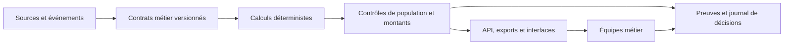

# Engineering portfolio — Jaber Bouchouit

**Transformer un besoin métier en système exploitable, contrôlable et transmissible.**

Ce portfolio présente quatre études de cas anonymisées issues de systèmes privés. Il explicite les décisions d'architecture, les invariants métier et les limites de validation. État documentaire arrêté au **7 octobre 2026** ; cet instantané ne constitue pas une garantie de disponibilité future.

## Parcours de lecture — deux minutes

| Besoin | Système | Décision à retenir | État documenté |
|---|---|---|---|
| Suivre les achats jusqu'aux réceptions | [Supply chain](cases/01-supply-chain.md) | Révision approuvée immuable, contrôle cumulatif, validation humaine | Projections opérationnelles ; autres modules déployés avec recettes ouvertes |
| Fiabiliser les clôtures | [Reporting financier](cases/02-financial-reporting.md) | Population explicite, rapprochement par ligne, mois clos protégés | Flux en service ; validations et limites précisées par fonction |
| Comprendre les parcours e-commerce | [Mesure](cases/03-commerce-measurement.md) | Consentement, minimisation et séparation mesure/finance | Collecte déployée ; complétude et acceptation distinctes |
| Produire et traduire des vidéos | [Workflows IA](cases/04-ai-workflows.md) | Devis figé, états persistants, reprise des opérations incertaines | Chaîne déployée ; qualité créative encore à valider |

## Ce que ces projets montrent

- **Architecture :** partir des domaines métier et isoler les sources de vérité, plutôt que choisir une pile avant de définir le problème.
- **Données :** distinguer une valeur inconnue de zéro, une observation technique d'un montant comptable, un total juste d'une population correcte.
- **Sécurité :** contrôler les accès et les données conservées à chaque frontière ; protéger les pièces et les identifiants.
- **Coûts :** réutiliser les données stockées, éviter les appels doublonnés et soumettre les traitements payants à un devis.
- **Delivery :** mettre en scène les cas limites, vérifier sur copie, sauvegarder, publier puis vérifier le parcours réel.
- **Transmission :** conserver décisions, versions, preuves et prochain point de reprise pour les développeurs et les équipes métier.

## Un exemple qu'on peut réellement vérifier

Le dépôt [business-metrics-contracts](https://github.com/jaberbouchouit/business-metrics-contracts) démontre, avec des données fictives, la traduction d'une règle métier en code et en table de décision. Les tests couvrent les frontières de date, les événements absents, les doublons, les remboursements et le rapprochement des flux entre mois.

## Architecture transversale

Lire aussi : [arbitrages techniques](architecture/decisions.md), [méthode de livraison](delivery/working-agreement.md), [périmètre des preuves](EVIDENCE.md).

Les sources applicatives, les données clients et les infrastructures de ces projets restent privées. Les études de cas présentent les décisions et les preuves disponibles, avec leurs limites de validation.
