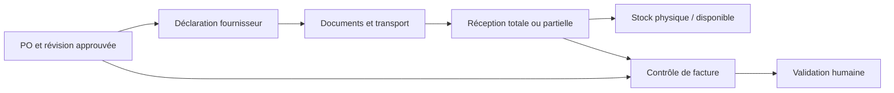

# Supply chain — du PO à la réception

## Besoin métier

Relier une décision d'achat aux quantités effectivement reçues, aux factures fournisseur et au stock utilisable. Le défi tient aux révisions de commande, aux réceptions partielles et aux différences entre stock physique et stock disponible.

## Système et décisions

Le système comporte un référentiel d'articles, des Purchase Orders versionnés, un portail fournisseur, les réceptions, les contrôles de facture et la valorisation. L'architecture exploitée est un monolithe FastAPI avec templates et JavaScript ciblé, une base SQLite et des traitements planifiés sous Linux.

| Décision | Pourquoi elle compte |
|---|---|
| Quantité saisie par l'opérateur faisant foi | Un calcul de capacité carton ne doit pas augmenter silencieusement la commande ni sa valeur |
| Révision approuvée conservée | Le contrôle financier doit retrouver les conditions réellement approuvées |
| Factures et réceptions contrôlées cumulativement | Plusieurs factures partielles peuvent dépasser le PO même si chaque facture isolée semble acceptable |
| Stock physique séparé du disponible | La valorisation patrimoniale et la décision de réapprovisionnement utilisent des populations différentes |
| Recommandation séparée de la commande | L'automatisation prépare une décision ; l'opérateur approuve l'engagement fournisseur |

## Validation et résultat technique

Les preuves internes décrivent des vérifications de cohérence entre quantité saisie, aperçu, document généré et enregistrement. Les corrections de commandes sont conservées comme nouvelles révisions. Les projections ont un historique protégé et des contrôles avant publication.

Cela rend les écarts explicables : on peut retrouver une révision, une réception et le contrôle associé, au lieu de modifier un total pour le faire coïncider.

## État et limites au 7 octobre 2026

Les projections de stock sont opérationnelles. Les PO sont déployés et en recette active. Réceptions, contrôle des factures, paiements et plusieurs autres écrans sont déployés avec validation métier encore ouverte. La valorisation FIFO conserve un statut d'audit tant que les couches de coût initiales ne sont pas approuvées.

La présence de ces modules ne prouve pas l'achèvement du périmètre ERP initial. L'observabilité technique, la séparation de certains domaines et la restauration sur une autre machine restent des sujets explicites.

**Contribution présentée :** pilotage technique des règles, contrôles et exploitation ; les validations d'achat et de finance appartiennent aux équipes métier.
