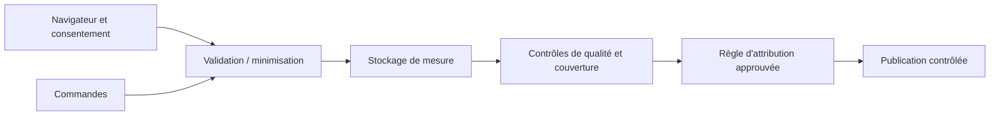

# Mesure e-commerce — collecter avant de conclure

## Besoin métier

Observer les parcours et les sources d'acquisition sans publier de métrique d'attribution dont la couverture ou la définition n'est pas suffisamment connue.

## Architecture et décisions

Un collecteur de commandes et un pixel navigateur alimentent des tables dédiées. La validation d'origine, le schéma des événements, les limites d'ingestion et la déduplication interviennent avant le stockage. Les règles de classement des canaux sont partagées entre sources.

| Frontière | Choix retenu |
|---|---|
| Identité | Identifiants pseudonymisés côté serveur quand le consentement le permet |
| Consentement absent ou refusé | Pas de cookie persistant ; identité limitée selon le mode anonyme prévu |
| Données conservées | Schéma fermé, minimisation, rejet des valeurs personnelles interdites |
| Historique | Rétention et effacement définis, traitements de purge distincts |
| Finance | L'événement d'achat navigateur est une observation technique, pas une preuve comptable |
| Interprétation | Couverture insuffisante ou jointure absente ne devient pas une certitude d'attribution |

## Vérification

Les tests et contrôles documentés portent sur les origines, les événements rejetés, les doublons, le consentement, les catégories de données conservées et les règles de canal. Une mesure datée d'ingestion décrit des événements effectivement reçus ; elle ne vaut pas validation permanente de toute la mesure.

## État et limites

La collecte est déployée. La qualité de couverture, les parcours issus de sites non instrumentés et les conditions de jointure restent des limites explicites. Un mode anonyme ne permet pas de revendiquer un rapprochement individuel des sessions et des commandes.

Cette étude ne revendique ni conformité juridique certifiée, ni précision d'attribution universelle, ni hausse de ROAS. Elle montre la séparation entre collecte, qualité de données et décision de publication.
