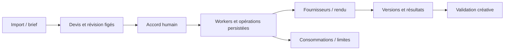

# Workflows IA — production créative, états et dépenses

## Besoin métier

Orchestrer traduction, traitement audio, sous-titres et montage vidéo dans une interface utilisable par une équipe, avec conservation des versions et maîtrise des appels payants.

## Système

Une interface React pilote une API FastAPI, PostgreSQL et des workers dédiés. Les opérations fournisseurs, les révisions et les consommations sont persistées. La chaîne déployée associe des fournisseurs vidéo, la transcription et un moteur de rendu sur CPU.

## Arbitrages

- **Issue incertaine d'un appel payant :** retrouver le reçu et l'identité d'opération avant toute nouvelle soumission. Une tentative de reprise ne doit pas provoquer une seconde dépense.
- **Devis et révision liés :** une modification du contenu invalide l'accord associé au devis précédent.
- **Accès par organisation et marque :** vérifier le contexte avant lecture de média, résultat ou envoi fournisseur.
- **Coûts et capacité :** prévoir limites, concurrence fournisseur, espace disque et purge ; la présence du mécanisme ne prouve pas que chaque plafond est renseigné.
- **Migration applicative :** sauvegarder et vérifier le schéma sur copie ; bloquer une publication dont la restauration cohérente n'est pas démontrée.

## Preuves et limites

La chaîne vidéo et les lots de traduction sont déployés. Un traitement avec des fournisseurs réels et un rendu de montage sont documentés. Ces preuves montrent l'exécution technique, pas l'acceptation de la qualité créative par l'équipe.

Une extension de création vidéo possède des tests locaux et une recette simulée mais reste non déployée dans l'état observé. L'ouverture d'un export dans le véritable logiciel de montage, plusieurs validations créatives et des paramètres budgétaires restent ouverts.

**Signal de leadership technique :** distinguer un test simulé, un appel réel, un service déployé et une qualité métier acceptée ; conserver ces frontières dans la décision de livraison.
